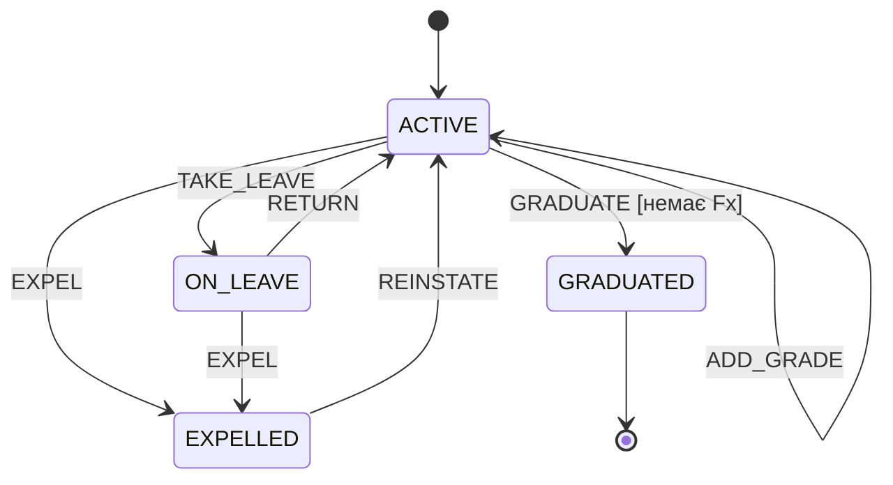

# ЛР 3. Переходи станів — Р-18

**Тестова база:** Р-18 лабораторної № 3. Початковий стан нового студента — `ACTIVE`. Подія виставлення оцінки (`add_grade`) є самопереходом і допустима тільки в `ACTIVE`. Для недопустимої події очікуються `InvalidTransitionError`, незмінний статус та незмінний список оцінок.

## Діаграма

Позначення `GRADUATED --> [*]` означає завершення життєвого циклу; жодна подія з цього стану не повинна бути допустимою.

## Повна таблиця станів

| Стан \ подія | TAKE_LEAVE | RETURN | EXPEL | REINSTATE | GRADUATE | ADD_GRADE |
|---|---|---|---|---|---|---|
| ACTIVE | ON_LEAVE | — | EXPELLED | — | GRADUATED [немає Fx] | ACTIVE |
| ON_LEAVE | — | ACTIVE | EXPELLED | — | — | — |
| EXPELLED | — | — | — | ACTIVE | — | — |
| GRADUATED | — | — | — | — | — | — |

Разом **24 пари стан–подія: 7 допустимих і 17 недопустимих**. Для `ACTIVE + GRADUATE` окремо перевірено хибну умову `[немає Fx]`.

## Виконані тестові випадки

`ТВ-ST-01` — одна послідовність від нового студента, мінімальна кількість тестових послідовностей для покриття всіх семи допустимих переходів (0-switch). `add_grade` додає бал 80; решта кроків не змінює оцінки. Фактичні повернені значення і стани наведені для кожного кроку.

| Крок ТВ-ST-01 | Подія | Очікуваний статус | Фактичний результат | Статус після кроку | Оцінок після кроку | Статус тесту |
|---|---|---|---|---|---:|---|
| 1 | ADD_GRADE | ACTIVE | `None` | ACTIVE | 1 | Пройдено |
| 2 | TAKE_LEAVE | ON_LEAVE | `<Status.ON_LEAVE: 'академвідпустка'>` | ON_LEAVE | 1 | Пройдено |
| 3 | RETURN | ACTIVE | `<Status.ACTIVE: 'навчається'>` | ACTIVE | 1 | Пройдено |
| 4 | EXPEL | EXPELLED | `<Status.EXPELLED: 'відрахований'>` | EXPELLED | 1 | Пройдено |
| 5 | REINSTATE | ACTIVE | `<Status.ACTIVE: 'навчається'>` | ACTIVE | 1 | Пройдено |
| 6 | TAKE_LEAVE | ON_LEAVE | `<Status.ON_LEAVE: 'академвідпустка'>` | ON_LEAVE | 1 | Пройдено |
| 7 | EXPEL | EXPELLED | `<Status.EXPELLED: 'відрахований'>` | EXPELLED | 1 | Пройдено |
| 8 | REINSTATE | ACTIVE | `<Status.ACTIVE: 'навчається'>` | ACTIVE | 1 | Пройдено |
| 9 | GRADUATE | GRADUATED | `<Status.GRADUATED: 'випускник'>` | GRADUATED | 1 | Пройдено |

Для ТВ-ST-02 студент одразу створений зі статусом `ACTIVE` і оцінкою Fx=50; для ТВ-ST-03…19 початковий статус задано **конструктором** (`status=Status.X`), що допускає п. 1.3 завдання. Кожен рядок містить одну спробу забороненої події. «Стан після» й «Оцінки до→після» дозволяють перевірити відсутність побічної зміни.

| ID | Покриває; передумова | Крок | Очікуваний результат | Фактичний результат | Стан після; оцінки до→після | Статус |
|---|---|---|---|---|---|---|
| ТВ-ST-02 | умова [немає Fx] хибна: ACTIVE; Fx=50 | `change_status(Event.GRADUATE)` | `InvalidTransitionError`; статус і оцінки незмінні | `InvalidTransitionError: не можна випустити студента з оцінками Fx` | ACTIVE; 1→1 | Пройдено |
| ТВ-ST-03 | недопустима пара: ACTIVE | `change_status(Event.RETURN)` | `InvalidTransitionError`; статус і оцінки незмінні | `InvalidTransitionError: подія «повернути з академвідпустки» неможлива для статусу «навчається»` | ACTIVE; 0→0 | Пройдено |
| ТВ-ST-04 | недопустима пара: ACTIVE | `change_status(Event.REINSTATE)` | `InvalidTransitionError`; статус і оцінки незмінні | `InvalidTransitionError: подія «поновити» неможлива для статусу «навчається»` | ACTIVE; 0→0 | Пройдено |
| ТВ-ST-05 | недопустима пара: ON_LEAVE | `change_status(Event.TAKE_LEAVE)` | `InvalidTransitionError`; статус і оцінки незмінні | `InvalidTransitionError: подія «надати академвідпустку» неможлива для статусу «академвідпустка»` | ON_LEAVE; 0→0 | Пройдено |
| ТВ-ST-06 | недопустима пара: ON_LEAVE | `change_status(Event.REINSTATE)` | `InvalidTransitionError`; статус і оцінки незмінні | `InvalidTransitionError: подія «поновити» неможлива для статусу «академвідпустка»` | ON_LEAVE; 0→0 | Пройдено |
| ТВ-ST-07 | недопустима пара: ON_LEAVE | `change_status(Event.GRADUATE)` | `InvalidTransitionError`; статус і оцінки незмінні | `InvalidTransitionError: подія «випустити» неможлива для статусу «академвідпустка»` | ON_LEAVE; 0→0 | Пройдено |
| ТВ-ST-08 | недопустима пара: ON_LEAVE | `add_grade(Grade("Python",80))` | `InvalidTransitionError`; статус і оцінки незмінні | `None` | ON_LEAVE; 0→1 | **Не пройдено** |
| ТВ-ST-09 | недопустима пара: EXPELLED | `change_status(Event.TAKE_LEAVE)` | `InvalidTransitionError`; статус і оцінки незмінні | `InvalidTransitionError: подія «надати академвідпустку» неможлива для статусу «відрахований»` | EXPELLED; 0→0 | Пройдено |
| ТВ-ST-10 | недопустима пара: EXPELLED | `change_status(Event.RETURN)` | `InvalidTransitionError`; статус і оцінки незмінні | `InvalidTransitionError: подія «повернути з академвідпустки» неможлива для статусу «відрахований»` | EXPELLED; 0→0 | Пройдено |
| ТВ-ST-11 | недопустима пара: EXPELLED | `change_status(Event.EXPEL)` | `InvalidTransitionError`; статус і оцінки незмінні | `InvalidTransitionError: подія «відрахувати» неможлива для статусу «відрахований»` | EXPELLED; 0→0 | Пройдено |
| ТВ-ST-12 | недопустима пара: EXPELLED | `change_status(Event.GRADUATE)` | `InvalidTransitionError`; статус і оцінки незмінні | `InvalidTransitionError: подія «випустити» неможлива для статусу «відрахований»` | EXPELLED; 0→0 | Пройдено |
| ТВ-ST-13 | недопустима пара: EXPELLED | `add_grade(Grade("Python",80))` | `InvalidTransitionError`; статус і оцінки незмінні | `InvalidTransitionError: не можна виставити оцінку відрахованому студенту` | EXPELLED; 0→0 | Пройдено |
| ТВ-ST-14 | недопустима пара: GRADUATED | `change_status(Event.TAKE_LEAVE)` | `InvalidTransitionError`; статус і оцінки незмінні | `InvalidTransitionError: подія «надати академвідпустку» неможлива для статусу «випускник»` | GRADUATED; 0→0 | Пройдено |
| ТВ-ST-15 | недопустима пара: GRADUATED | `change_status(Event.RETURN)` | `InvalidTransitionError`; статус і оцінки незмінні | `InvalidTransitionError: подія «повернути з академвідпустки» неможлива для статусу «випускник»` | GRADUATED; 0→0 | Пройдено |
| ТВ-ST-16 | недопустима пара: GRADUATED | `change_status(Event.EXPEL)` | `InvalidTransitionError`; статус і оцінки незмінні | `<Status.EXPELLED: 'відрахований'>` | EXPELLED; 0→0 | **Не пройдено** |
| ТВ-ST-17 | недопустима пара: GRADUATED | `change_status(Event.REINSTATE)` | `InvalidTransitionError`; статус і оцінки незмінні | `InvalidTransitionError: подія «поновити» неможлива для статусу «випускник»` | GRADUATED; 0→0 | Пройдено |
| ТВ-ST-18 | недопустима пара: GRADUATED | `change_status(Event.GRADUATE)` | `InvalidTransitionError`; статус і оцінки незмінні | `InvalidTransitionError: подія «випустити» неможлива для статусу «випускник»` | GRADUATED; 0→0 | Пройдено |
| ТВ-ST-19 | недопустима пара: GRADUATED | `add_grade(Grade("Python",80))` | `InvalidTransitionError`; статус і оцінки незмінні | `None` | GRADUATED; 0→1 | **Не пройдено** |

**Покриття станів:** 4/4 (100 %). **Покриття допустимих переходів:** 7/7 (100 %), одна послідовність. **Покриття всіх пар:** 24/24 (100 %): 7 допустимих у ТВ-ST-01 та 17 недопустимих у ТВ-ST-03…19. Хибна умова випуску перевірена додатковим ТВ-ST-02. Пройдено 16/19 тестових випадків; три недопустимі події виконалися або змінили дані.
