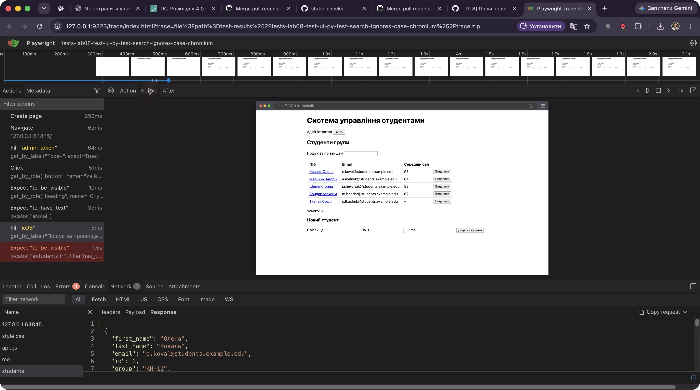
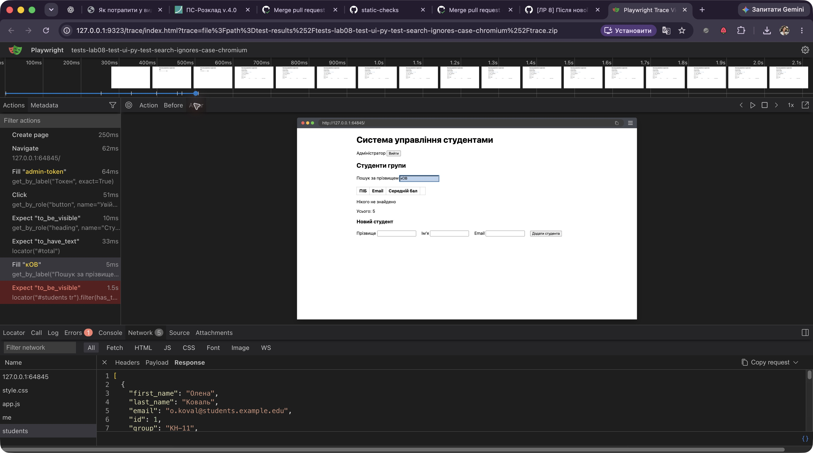
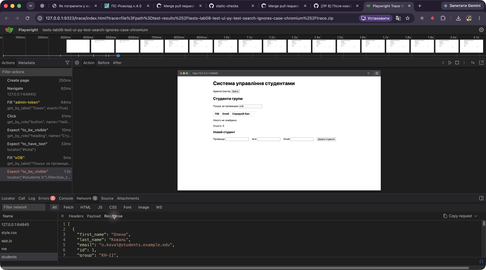

# ЛР 8 — розбір трасування Playwright

**Галух Анна Олександрівна, 63М.** Розібрано дефект [#42](https://github.com/asiaglh/testing-course-halukh/issues/42), тест `test_search_ignores_case`. Для однієї відмови виконано:

```sh
cd app
uv run pytest tests/lab08/test_ui.py -k test_search_ignores_case \
  --runxfail --tracing retain-on-failure --screenshot only-on-failure
uv run playwright show-trace \
  test-results/tests-lab08-test-ui-py-test-search-ignores-case-chromium/trace.zip
```

Результат із вимкненим `xfail`: **1 failed**. У переглядачі обрано дію `Fill "кОВ"` для поля «Пошук за прізвищем». До дії DOM містив рядок «Коваль Олена»; після дії поле містило `кОВ`, а таблиця стала порожньою з написом «Нікого не знайдено». Це розходження з Р-25 відбувається саме під час введення, до наступної перевірки `to_be_visible`.





На вкладці **Network** видно `GET /api/students` зі статусом **200 OK**. У JSON відповіді є студент із `last_name: "Коваль"`, `average: 92.5`; отже, API надав запис. Після введення пошукового тексту нового запиту немає: фільтр працює локально в браузері.



Причина підтверджена кодом `renderStudents()` в `app/src/student_portal/web/app.js`: вираз `s.last_name.includes(query)` порівнює регістр буквально. Узгоджене виправлення — нормалізувати регістр і прізвища, і запиту перед порівнянням; тест після виправлення має стати XPASS і тоді його слід перевести в звичайний тест. Локальне `trace.zip` лишається в `app/test-results/` для показу в переглядачі; у CI трасування відмов завантажується артефактом `playwright-traces`.
